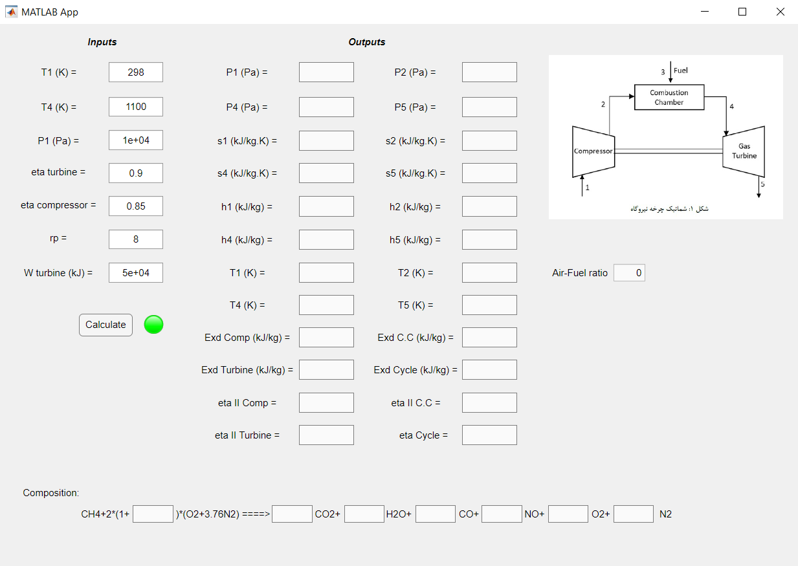

# Gas Turbine Thermodynamic Analysis

A Thermodynamics II coursework project by **Pouya Asghari**, University of Tehran. MATLAB, CoolProp, and App Designer are used to model a methane-fired gas turbine, combustion products, component exergy losses, and first- and second-law efficiencies.

New to GitHub? Follow the [step-by-step upload guide](docs/GITHUB_GUIDE.md).

## Objective

Connect compressor calculations, methane-air combustion equilibrium, turbine expansion, and energy/exergy calculations through a MATLAB graphical interface.

## Methods

- CoolProp thermophysical property calls and isentropic-efficiency relations.
- Element balances for six combustion-product species.
- Equilibrium relations for carbon dioxide dissociation and nitric oxide formation.
- Excess-air and outlet-temperature searches.
- App Designer callbacks for input and output display.

## Example inputs

Original example settings; not a validated operating point.

| Input | Value |
| --- | --- |
| Inlet temperature | 298 K |
| Inlet pressure | 10,000 Pa |
| Pressure ratio | 8 |
| Compressor efficiency | 0.85 |
| Turbine efficiency | 0.90 |
| Turbine inlet temperature | 1,100 K |
| Specific turbine work argument | 50,000; J/kg on the CoolProp mass-specific basis, despite inconsistent source labels |

## Results and limitations

The supplied report documents the method and interface but contains no completed results table or independent validation. The screenshot has empty outputs. Historical code contains hard-coded excess air, inconsistent property-basis conversions, search issues, and different scaling factors across versions. Treat efficiency and exergy outputs as unverified until resolved. See [technical notes](docs/TECHNICAL_NOTES.md) and the report's editorial appendix.

No verified numerical performance improvement, emissions prediction, or successful simulation rerun is claimed.

## Files

| Path | Purpose |
| --- | --- |
| [report/main.pdf](report/main.pdf) | English report and separate editorial review |
| [report/main.tex](report/main.tex) | Editable LaTeX source |
| `report/figures/`, `report/listings/` | Required report assets |
| [report/BUILD.md](report/BUILD.md) | Compilation instructions |
| [matlab/gasturbn.mlx](matlab/gasturbn.mlx) | Unchanged original Live Script |
| [matlab/gasturbn_original.m](matlab/gasturbn_original.m) | Readable code extracted from the Live Script |
| [matlab/GasTur.m](matlab/GasTur.m) | Function extraction with relative dependency path; numerical logic unchanged |
| [app/app1.mlapp](app/app1.mlapp) | Unchanged original App Designer project |
| [app/app1_export.m](app/app1_export.m) | Readable app code for inspection |
| [app/Schematic.jpg](app/Schematic.jpg) | Original app schematic |
| [third_party/coolprop_legacy.zip](third_party/coolprop_legacy.zip) | Original supplied dependency files |
| [docs/RUNNING.md](docs/RUNNING.md) | Dependency and execution workflow |

## Requirements and running

MATLAB with App Designer and Symbolic Math Toolbox is required. The supplied legacy CoolProp SWIG wrapper includes a Windows 64-bit MEX binary; compatibility with your MATLAB release needs checking. Native programs were not run during conversion.

Follow [RUNNING.md](docs/RUNNING.md) to extract dependencies and open the app. The app embeds its own model and retains a machine-specific path. Editing the separate `GasTur.m` does not update the embedded function.

## Build the report

Upload the report-only ZIP to Overleaf, select `main.tex`, and compile with pdfLaTeX. No custom font is required. The report is independent of MATLAB and CoolProp. See [BUILD.md](report/BUILD.md).

## Academic context and provenance

Thermodynamics II, Project One, first semester of academic year 1403–1404 (Iranian calendar), School of Mechanical Engineering, College of Engineering, University of Tehran.

The Persian report was translated with AI assistance. Section headings and editorial notes were added. Original screenshots are retained. Native MLX, MLAPP, schematic, and dependency bytes are preserved. Readable `.m` exports are derived files; `GasTur.m` additionally changes the dependency path and removes surrounding script commands and the sample call. No numerical corrections are included.

## License and attribution

No license has been selected for the original project. Choose one before granting reuse permissions. CoolProp retains its own terms; no license text was included in the supplied dependency directory. Consult the [upstream project](https://github.com/CoolProp/CoolProp) for licensing and attribution independently of any coursework license.
